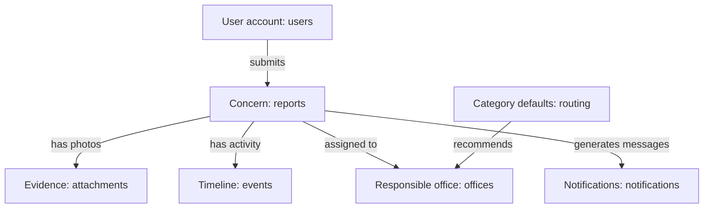

# Understanding the IIT Voice database

This guide explains the database added during the Supabase integration: what it stores, why the tables exist, and how they connect to the screens in IIT Voice. It describes the current implementation, rather than a proposed design.

## 1. The basic terms

Think of the database as a workbook containing several spreadsheets.

| Term            | Plain explanation                            | IIT Voice example                            |
| --------------- | -------------------------------------------- | -------------------------------------------- |
| Database        | The place where the system saves information | The PostgreSQL database hosted by Supabase   |
| Schema          | A named group of tables inside that database | `iit_voice`                                  |
| Table           | A collection of the same kind of information | `reports` contains concerns                  |
| Row or record   | One item in a table                          | One submitted concern                        |
| Column or field | One piece of information about an item       | A report's title or status                   |
| Primary key     | A value that uniquely identifies a row       | A report's `id`                              |
| Foreign key     | A reference to a row in another table        | A report's `reporter_id` identifies its user |

The tables were created by the application's database setup script. You did not need to create each table manually in Supabase.

## 2. What each table does

There are 11 application tables in the `iit_voice` schema.

| Table            | What it stores                                                                                                          | Where you encounter it                            |
| ---------------- | ----------------------------------------------------------------------------------------------------------------------- | ------------------------------------------------- |
| `users`          | Account names, email addresses, password hashes, roles, verification, active status, affiliation, and office membership | Sign in, account requests, Users & access         |
| `reports`        | The concerns themselves: title, description, categories, location, map coordinates, priority, status, and assignments   | Report form, report lists, map pins, review queue |
| `attachments`    | Uploaded evidence images, their filenames, image types, and associated metadata                                         | Evidence photos and before/after comparisons      |
| `events`         | A concern's activity history, including updates, decisions, and progress messages                                       | Report activity inside a concern                  |
| `notifications`  | Messages addressed to particular users and whether they have been read                                                  | Notification bell and unread count                |
| `offices`        | The list of responsible offices                                                                                         | Responsible office selections and office accounts |
| `routing`        | The default office associated with each category                                                                        | Recommended office when a concern is assessed     |
| `sessions`       | Information used to recognize a signed-in user until the session expires                                                | Staying signed in between requests                |
| `login_limits`   | Login attempt counts and timing used to limit repeated attempts                                                         | Login protection                                  |
| `audit`          | A separate record of administrative and system actions                                                                  | Main Admin's Audit log                            |
| `photo_analyses` | Saved AI screening results and analysis metadata associated with a user and photo fingerprint                           | Photo assistance and analysis checks              |

The `users.password` column contains a password **hash**, not the original readable password. The `sessions` table stores a hash of the session token.

### Why are events and audit separate?

`events` explains what happened to a particular concern, such as a validation decision or a work update. Some events can be internal staff notes.

`audit` records administrative and system actions for oversight, such as account or routing changes. It serves a different purpose from the concern's activity timeline.

### Why are attachments separate from reports?

A single concern can have several photos. Keeping photos in their own table allows each image to have its own filename and metadata while remaining linked to the same concern.

In this version, the actual image bytes are stored in PostgreSQL in the `attachments.content` column. The database type is called `BYTEA`. The application serves those images through its authenticated API; they are not stored in a public Supabase Storage bucket.

## 3. Where the report form inputs go

The form's inputs generally become columns in one row of `reports`. There is no need for a separate table for each input.

| Form information                                     | Database field                             |
| ---------------------------------------------------- | ------------------------------------------ |
| Title                                                | `reports.title`                            |
| Describe what you observed                           | `reports.description`                      |
| Primary category                                     | `reports.category`                         |
| Selected categories, including additional categories | `reports.categories`                       |
| Campus location                                      | `reports.location`                         |
| Floor, room, or other location details               | `reports.location_details`                 |
| Selected map position                                | `reports.latitude` and `reports.longitude` |
| Urgency                                              | `reports.priority`                         |
| Workflow state                                       | `reports.status`                           |
| Person who submitted it                              | `reports.reporter_id`                      |
| Responsible office                                   | `reports.office_id`                        |
| Assigned administrator                               | `reports.assigned_to`                      |
| Evidence photo                                       | A linked row in `attachments`              |

`reports.categories` stores a list as JSON text. This lets one concern appear under multiple category filters without creating several copies of that concern.

The report also has visibility and public-summary fields. These support sharing an approved campus summary while keeping restricted report details and evidence subject to access checks.

## 4. How the tables connect

For example, imagine a student reports a leaking classroom ceiling.

1. The student already has a row in `users`.
2. Submitting the form creates a row in `reports`.
3. The report's `reporter_id` links it to that student.
4. Each uploaded photo becomes a row in `attachments`, linked by `report_id`.
5. Validation and work updates become rows in `events` for that report.
6. The responsible office is linked through `reports.office_id`.
7. Notifications are saved for the users who need to be informed.



The connecting IDs let the system retrieve the correct photos, updates, reporter, and office for a concern.

## 5. How this supports the roles

| Role               | Main responsibility                                                                                       |
| ------------------ | --------------------------------------------------------------------------------------------------------- |
| Reporter           | Submit concerns and follow their own reports; view approved shared campus summaries                       |
| Validator          | Review validity, assess urgency, and assign valid concerns to an office and administrator                 |
| Responsible Office | View concerns assigned to its office and manage work progress and evidence                                |
| Main Admin         | Manage accounts and routing, oversee concerns, control publication, and handle final closure or reopening |

The Python API checks who is signed in and whether that account can perform the requested action. Having a row in a table does not mean every user can see it.

The internal role values are `student`, `validator`, `office`, and `admin`. Reporter types such as student and faculty are also represented through the account's affiliation. The internal value `student` is used for the reporter role; it does not mean every reporter is necessarily a student.

## 6. Where the dashboard charts come from

The charts summarize existing reports. They do not need a separate table for each graph.

For example:

- Reports received: count matching reports.
- Reports over time: group reports by submission date.
- Category chart: count reports matching each category; one report can match several.
- Current status: group reports by their current status.
- Office workload: group reports by their assigned office.
- Map concentration: summarize reports with usable map coordinates.

Filters change which reports are included in those calculations.

## 7. Supabase, Vercel, and the Python API

The deployed request flow is:

```text
Browser interface
    → Python API running on Vercel
    → PostgreSQL database hosted by Supabase
    → Python API returns the permitted information
    → Browser displays it
```

**Supabase hosts the database. Vercel hosts the deployed website and Python API.**

The current implementation uses IIT Voice's own Python login and session handling. It does **not** use Supabase Auth. Consequently, application accounts appear in `iit_voice.users`, rather than under Supabase's Authentication → Users screen.

The database connection string stays on the server. The browser talks to the Python API instead of connecting directly to the database.

Online demos use a second schema, `iit_voice_demo`, in the same Supabase project. It has its own copies of these tables and a restricted database login that cannot access `iit_voice`. Normal sign-in uses regular records; a demo button starts a session using demo records. Testers share those demo records. See `DEMO_AND_QR_GUIDE.md` for setup and the difference from local SQLite demos.

## 8. Finding the tables in Supabase

Open the project's Table Editor and select the **`iit_voice` schema**. Looking only at the `public` schema can make it appear that the application has no tables.

The schema has row-level security enabled, with no browser Data API policies. The server connects using the configured database owner connection and enforces the application's permissions. These tables are intended to be accessed through the Python API.

An empty table is not necessarily an error. For example, `attachments` stays empty until a photo is saved, and `events` starts filling as report activity is recorded. This guide deliberately does not include live record counts because those change during use.

## 9. Local data versus cloud data

- In normal mode, when `DATABASE_URL` is configured, the backend uses Supabase PostgreSQL.
- When it is blank, the local backend uses SQLite.
- The local demo server (`IIT_VOICE_DEMO_LOGIN=1`) uses a separate SQLite test database in `data/demo`, or the directory selected by `IIT_VOICE_DATA`. Demo sessions do not use the configured live Supabase connection. Disable demo mode and restart to return to normal data.
- Local SQLite accounts and reports are not automatically copied into Supabase.
- The deployed API requires its cloud database configuration; it does not fall back to a temporary local database.

This explains why an account created in the old local database may not exist in the cloud database.

## 10. Files that define this implementation

These paths are relative to the project folder:

| File                                             | Purpose                                                                                  |
| ------------------------------------------------ | ---------------------------------------------------------------------------------------- |
| `supabase/migrations/202610270001_iit_voice.sql` | Creates the private schema, tables, relationships, indexes, and database access settings |
| `database.py`                                    | Adapts the database connection and shared queries for PostgreSQL                         |
| `server.py`                                      | Handles application actions, authentication, permissions, and database reads and writes  |
| `api/index.py`                                   | Makes the shared Python API available on Vercel                                          |
| `SUPABASE_SETUP.md`                              | Explains installation, configuration, initialization, and deployment                     |

## 11. A short explanation you can use when presenting

> IIT Voice stores its information in a PostgreSQL database hosted by Supabase. Related information is organized into tables for users, reports, evidence, activity, offices, notifications, and supporting security records. Each concern links to its reporter, photos, updates, and assigned office through identifying keys. The website sends requests to a Python API, which checks the user's permissions before reading or changing data. Dashboard charts summarize those saved reports.

For a step-by-step review, start with `users` and `reports`, then follow one concern through `attachments`, `events`, `offices`, and `notifications`. The remaining tables support those visible workflows.
